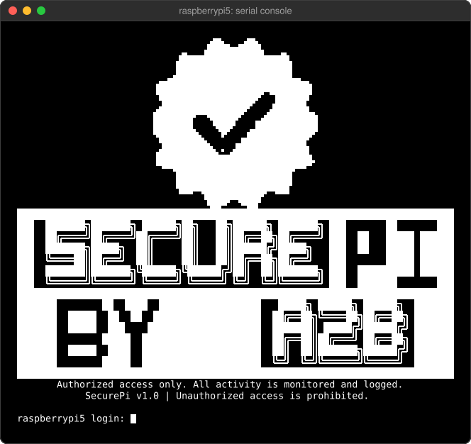

<p align="center">
  
</p>

# SecurePi

A hardened embedded Linux image for the Raspberry Pi 5, built with Yocto (Scarthgap 5.0 LTS). Each security control in this README is a recipe or config in the `meta-securepi` layer, was tested on real hardware, and exists to stop a specific attack.

Status values used below: **Done** (implemented and tested on hardware), **In progress**, **Planned**.

## Threat model

The device is meant to sit in the field as an IoT edge node. The attacker is assumed to be able to:

- **Hold the device.** Pull the SD card, read or rewrite it on another machine, clip a logic analyzer onto the GPIO/TPM header, power cycle it at will ("evil maid").
- **Get a root shell** through a service bug, a supply-chain problem or the serial console.
- **Sit on the network** and spoof, redirect, flood or intercept traffic.

No single control is trusted on its own. Secure boot assumes someone will try to swap the kernel, dm-verity assumes they will edit the root filesystem, the TPM assumes they will clone the disk, SELinux assumes they will get root anyway, and the TPM session encryption assumes they will probe the bus.

## Overview

| Layer | Control | Stops | Status |
|---|---|---|---|
| Boot ROM to EEPROM | Signed bootcode and EEPROM, key hash burned into OTP | Running attacker firmware | Done |
| EEPROM to U-Boot | Signed `boot.img` (FAT image of the boot partition) | Editing the kernel, DTB, U-Boot or config on the SD card | Done |
| U-Boot to kernel | Signed FIT image, public key in U-Boot's control DTB | Booting a modified kernel | Done |
| Root filesystem | dm-verity, root hash inside the signed `boot.img` | Changing any file in the root filesystem | Done |
| Data partition | LUKS2 (AES-XTS), key sealed in the TPM | Reading a copied SD card | Done |
| Key release | Measured boot into PCR 8, key unseals only at the expected value | Booting a modified image to get the data key | Done |
| TPM bus | Salted, encrypted TPM sessions | Sniffing the LUKS key on the SPI bus | Done |
| Runtime | SELinux in enforcing mode | A compromised process doing anything it wants | Done |
| Kernel | Hardened kernel config and sysctl settings | Memory corruption exploits, info leaks, debug interfaces | Done |
| Attack surface | Minimal distro, no SUID busybox, sandboxed services, read-only rootfs | Persistence and privilege escalation | Done |
| Toolchain | Stack protector, FORTIFY_SOURCE, RELRO and BIND_NOW | Stack smashing, GOT overwrites | Done |
| Trusted execution | OP-TEE secure world (TrustZone) | Reading keys out of kernel memory | In progress |
| Updates | RAUC A/B with signed bundles and rollback | Unsigned or broken updates | Planned |
| Network | nftables deny by default, SSH hardening | Remote access, lateral movement | Planned |
| Telemetry | mTLS and TLS remote syslog | Reading or forging device logs | Planned |

## 1. Secure boot chain

The device runs only software signed with the owner's key, and the check is anchored in fuses that cannot be rewritten.

```
BCM2712 boot ROM  verifies  bootcode / EEPROM      (RSA signature, key hash in OTP)
EEPROM            verifies  boot.img               (signed FAT image of the boot partition)
U-Boot            verifies  fitImage (kernel+DTB)  (FIT signature, key in the control DTB)
```

| Control | What it prevents | Where |
|---|---|---|
| Public key hash burned into OTP | The root of trust is in one-time-programmable fuses. Reflashing the SD card or the SPI flash cannot change which key the chip trusts. | `securepi.conf`, `rpi-eeprom` bbappend |
| Signed `boot.img` | In secure boot mode the EEPROM refuses a boot partition with a bad signature, so `config.txt`, `cmdline.txt`, the DTB and U-Boot cannot be edited on the card. | `securepi-bootimg` |
| Signed FIT image | U-Boot checks the kernel and DTB against the key in its own control DTB before booting them. | `u-boot` bbappend, `securepi-fit-signature.cfg` |
| Control DTB at a safe address | `boot.scr` loads `u-boot.dtb` at `0x08000000`, clear of the area where the kernel is unpacked. An earlier overlap caused a reset loop. | `securepi-u-boot-scr.bb` |

**Use your own signing keys.** The repo only contains example public certificates (`keys/*.crt`), and private keys are never committed. The key that matches the OTP hash cannot be replaced, and an EEPROM signed with the wrong key will brick a locked board. See [SECURITY.md](SECURITY.md).

## 2. Root filesystem integrity (dm-verity)

The root filesystem is a read-only dm-verity device. A hash tree covers every 4 KiB block, and the root hash sits in `cmdline.txt` inside the signed `boot.img`, so it is protected by the secure boot chain.

This stops offline tampering: someone who takes out the SD card and plants a backdoor or edits a binary gets caught the moment a changed block is read. To change the root hash they would have to change `boot.img`, which breaks its signature and also changes PCR 8 (section 4).

Implemented with the `dm-verity-img` class from meta-security, `CONFIG_DM_VERITY` and `CONFIG_DM_INIT` (no initramfs needed), and `securepi-bootimg`, which writes the verity table into `cmdline.txt`.

## 3. Encrypted data partition (LUKS2)

The data partition (`/dev/mmcblk0p3`, mounted at `/run/securedata` with `nosuid,nodev,noexec`) is LUKS2 with AES-XTS. A copy of the SD card only gives ciphertext. The 64-byte key is never stored on disk; it is sealed in the TPM and released at boot (section 4).

Implemented with cryptsetup, `tpm-luks-provision.sh` (one time: wipes the partition, formats it and seals a new key) and `tpm-luks-unlock.sh` (at boot: unseals the key and opens the partition).

## 4. Measured boot and TPM-sealed key

The TPM (Infineon SLB9672 on the GPIO header) makes the data partition open only on a known-good boot.

| Control | What it prevents | Where |
|---|---|---|
| Measured boot into PCR 8 | Linux extends PCR 8 with the firmware's own digest of the verified `boot.img`, the secure boot flags and the EEPROM version. PCR 8 identifies this exact boot. | `tpm-measure-boot.sh` |
| Key sealed to PCR 8 (`fixedtpm\|fixedparent`, no `userwithauth`) | The TPM releases the LUKS key only when PCR 8 has the expected value. A modified image gives a different PCR 8 and the TPM refuses. Without `userwithauth` there is no password path around the policy. | `tpm-luks-provision.sh`, `tpm-luks-unlock.sh` |
| TPM reset on every boot (GPIO 24) | A warm reboot does not reset the TPM, so PCR values would carry over and never match. The TPM reset line is pulsed at every boot. | `tpm-reset.sh` |
| Kernel resource manager `/dev/tpmrm0` | Replaces the `tpm2-abrmd` daemon, so there is one less privileged process. `PACKAGE_EXCLUDE` fails the build if it comes back. | `securepi-image.bb` |

PCR 8 is a plain SHA-256 chain, so the expected value can be computed off-device from the `boot.img` hash before flashing.

## 5. TPM bus encryption

The TPM talks to the SoC over SPI at a few MHz, and a cheap logic analyzer on the header can record that traffic. This was tested on the device: a TSS trace showed the 64-byte LUKS key in clear text in the `TPM2_Unseal` response.

The fix covers both directions:

- **Unseal:** the session is salted (`tpm2_startauthsession --policy-session -c primary.ctx`). The Pi sends a salt encrypted to the TPM's public key, so both sides derive a session key a sniffer cannot compute. With `--enable-encrypt` the TPM encrypts the unseal response.
- **Provisioning:** a salted decrypt session protects the key on its way into `tpm2_create`. It has to be an HMAC session (`--hmac-session`); a plain `tpm2_startauthsession` creates a trial session, which cannot encrypt.

This stops a passive sniffer. An active device sitting between the SoC and the TPM is not handled yet; that needs a pinned TPM key and is part of the planned attestation work.

## 6. SELinux

The image boots with SELinux in enforcing mode and a targeted policy. Every process, file and socket has a label, and the kernel enforces the policy, so a compromised process is limited to what its domain allows. The custom `securepi` module confines an example service (`securepi_logger_t`) to reading its config and writing its log, and gives device-mapper, login and syslog only the permissions LUKS and boot need.

**Current gap:** the kernel is still built with `CONFIG_SECURITY_SELINUX_DEVELOP=y`, which lets root switch SELinux to permissive with `setenforce 0`. Turning this off is planned.

Implemented with the `selinux` distro feature, `DEFAULT_ENFORCING=enforcing`, the SELinux kernel options, `securepi-selinux-policy`, and a policy build step in `securepi-image.bb`. Requirements that are easy to miss (the `map` permission, `fd:use` on inherited descriptors, `filesystem:associate` for tmpfs) are commented in `securepi.te`.

## 7. Kernel hardening

Build-time config in `securepi-hardening.cfg` and runtime settings in `99-securepi.conf`. The build fails if any option in the fragment does not end up in the final kernel config.

| Control | What it prevents |
|---|---|
| `STACKPROTECTOR_STRONG`, `HARDENED_USERCOPY`, `STRICT_KERNEL_RWX`, `STRICT_MODULE_RWX` | Stack smashing, bad copies between user and kernel space, writable and executable kernel memory |
| `RANDOMIZE_BASE`, `randomize_va_space=2` | Exploits that rely on fixed addresses |
| `kptr_restrict=2`, `dmesg_restrict=1`, no `PROC_KCORE` | Leaking kernel addresses |
| `STRICT_DEVMEM`, `IO_STRICT_DEVMEM` | Reading or writing physical memory through `/dev/mem` |
| `DEBUG_FS_ALLOW_NONE`, `KGDB=n`, `MAGIC_SYSRQ=n` | Kernel debugger and SysRq on the reachable UART |
| `KEXEC=n` | Loading a different kernel at runtime and bypassing secure boot |
| `ptrace_scope=1`, `suid_dumpable=0`, `core_pattern=\|/bin/false` | Reading other processes' memory, secrets in core dumps |
| Network sysctls (`rp_filter`, no redirects or source routing, `syncookies`, no forwarding) | Spoofing, traffic redirection, SYN floods, routing through the device |

Modules are signed (`MODULE_SIG`), but unsigned modules are not refused yet: `MODULE_SIG_FORCE` is planned. `/proc/config.gz` is also still enabled (`IKCONFIG_PROC`) and will be removed together with the SELinux develop option.

## 8. Attack surface

| Control | What it prevents |
|---|---|
| Read-only root filesystem plus dm-verity | Writing a backdoor to `/`; a remount gets caught by dm-verity |
| Minimal distro (no X11, Wayland, OpenGL, Vulkan, Bluetooth, 3G, NFC; no `debug-tweaks`) | Less code to exploit, no debug shortcuts in the image |
| No SUID busybox (`BUSYBOX_SPLIT_SUID=0`) | A common local privilege escalation path |
| Sandboxed syslog (`NoNewPrivileges`, `ProtectSystem=full`, `ProtectHome`, `ProtectKernel*`, `RestrictAddressFamilies=AF_UNIX`, `MemoryDenyWriteExecute`) | A compromised logger gaining privileges, running shellcode or using the network |
| Root login disabled, console user `securepi` | Logging in as root directly |

**Current gap:** `securepi` has passwordless `sudo`, and the default console password is `123`, so anyone with the serial console and the default password gets root. Both are listed in [SECURITY.md](SECURITY.md) as defaults to change.

## 9. Toolchain hardening

Applied to every package through the distro `security` feature:

- `-fstack-protector-strong -D_FORTIFY_SOURCE=2 -Wformat-security -fpic` to catch stack smashing and unsafe libc calls.
- `-Wl,-z,relro,-z,now` (RELRO and BIND_NOW) so the GOT is read-only after startup.

## Attacks tested on hardware

Each control was checked the same way: run the attack against a build without the defense, then confirm the defense stops it on the Pi.

### Kernel and system hardening

| Attack | Without the defense | With the defense | Control |
|---|---|---|---|
| Read kernel pointers from `/proc/kallsyms` | Real addresses | All zeros | `kptr_restrict=2` |
| Read boot-time addresses with `dmesg` | Full kernel log | Denied for non-root | `dmesg_restrict=1` |
| `cat /proc/1/maps` as another user | Address layout of PID 1 | Permission denied | `ptrace_scope=1` |
| `su root` as `securepi` | Root shell | Fails, root account locked | No root login |
| Child process trying to gain privileges | Works | Blocked, `NoNewPrivs` is `1` | `NoNewPrivileges` |
| Read kernel memory through `/proc/kcore` | File present | File gone | `PROC_KCORE=n` |
| `mount -o remount,rw /` and write a backdoor | Worked | Closed by dm-verity (below) | dm-verity |

### Secure boot chain

| Attack | Result on hardware | Control |
|---|---|---|
| Boot a FIT kernel signed with the wrong key | U-Boot refuses it, no kernel boots | FIT signature check |
| Flash an EEPROM or `boot.img` signed with the wrong key on a locked board | Rejected by the EEPROM | OTP-anchored secure boot |

### dm-verity (SD card taken out and modified on another machine)

| Attack | Result on hardware |
|---|---|
| Mount the root partition read-write and append to a file | Superblock mismatch, `data block 0 is corrupted`, kernel panic at about 2.9 s |
| Patch bytes in place without changing any length (block 73442, located with `debugfs`) | Boots, but reading that block fails with an I/O error at about 7.4 s; the changed code never runs |

The partition was restored afterwards by writing `rootfs.ext4.verity` back with `dd`.

### TPM SPI bus sniffing

| Step | Result on hardware |
|---|---|
| Trace the TPM traffic during unseal (`TSS2_LOG`) | The 64-byte LUKS key visible in clear in the `TPM2_Unseal` response |
| Repeat with salted, encrypted sessions | Only ciphertext on the bus; the unsealed key still matches |
| Fresh image, provision, cold reboot | PCR 8 matched the computed value and the data partition unlocked through the encrypted session |

## Roadmap

| Area | Status |
|---|---|
| Minimal distro and toolchain hardening | Done |
| Kernel and system hardening | Done |
| SELinux enforcing with a custom policy | Done |
| LUKS2 data partition with a TPM-sealed key and measured boot | Done |
| Secure boot chain (OTP, EEPROM, boot.img, FIT) | Done |
| dm-verity root filesystem | Done |
| Encrypted TPM sessions | Done |
| OP-TEE trusted applications | In progress |
| Device identity, remote attestation, pinned TPM key | Planned |
| RAUC A/B updates with signed bundles | Planned |
| nftables firewall, SSH hardening | Planned |
| mTLS telemetry and remote logging | Planned |

## Hardware and host

| | |
|---|---|
| Target | Raspberry Pi 5, microSD card, SPI TPM 2.0 module on the GPIO header (tested with an Infineon SLB9672 board from LetsTrust) |
| Console | 3.3 V UART at 115200 baud, for example the Raspberry Pi Debug Probe. The image has no SSH and no Wi-Fi. |
| Build host | Linux (native or VM), ARM64 or x86-64, 100 GB or more free disk (see Getting started) |
| Yocto | Scarthgap (5.0 LTS), `linux-raspberrypi` 6.12, systemd |

## Getting started

### Requirements

- Raspberry Pi 5, microSD card, SPI TPM 2.0 module on the GPIO header, 3.3 V serial console
- Linux build host (native or VM), Ubuntu 22.04 or 24.04, ARM64 or x86-64
- 4 or more CPU cores, 8 GB RAM (16 GB recommended), 100 GB or more free disk

Host packages and kas:

```bash
sudo apt-get update
sudo apt-get install -y git python3 python3-pip gcc make chrpath diffstat \
  liblz4-tool zstd gawk wget file cpio xz-utils build-essential libssl-dev \
  libelf-dev texinfo iputils-ping curl
pip3 install kas
```

### Signing keys

The image is signed at build time, so create your own keys before the first
build. The repository only contains example public certificates.

```bash
git clone https://github.com/ahmedmoabdeldayem/securepi.git
cd securepi
mkdir -p keys/fit-signing keys/bootloader-signing

# FIT image (kernel + device tree), checked by U-Boot
openssl genrsa -out keys/fit-signing/securepi-fit-key.key 2048
openssl req -batch -new -x509 -days 3650 -subj "/CN=SecurePi FIT signing" \
  -key keys/fit-signing/securepi-fit-key.key -out keys/fit-signing/securepi-fit-key.crt

# EEPROM firmware and boot.img, checked by the boot ROM and the EEPROM
openssl genrsa -out keys/bootloader-signing/securepi-bootloader-key.key 2048
openssl req -batch -new -x509 -days 3650 -subj "/CN=SecurePi bootloader signing" \
  -key keys/bootloader-signing/securepi-bootloader-key.key \
  -out keys/bootloader-signing/securepi-bootloader-key.crt
```

Keep a backup of the private keys. Once the bootloader key hash is written to
the OTP fuses, that key cannot be replaced.

### Build

```bash
kas build kas.yml
```

kas clones the upstream layers listed in `kas.yml` and runs
`bitbake securepi-image`. The first build takes a few hours, later builds a few
minutes.

### Flash

```bash
lsblk    # find the SD card, never use the build host's own disk
bzcat build/tmp/deploy/images/raspberrypi5/securepi-image-raspberrypi5.rootfs.wic.bz2 \
  | sudo dd of=/dev/sdX bs=4M conv=fsync status=progress && sync
```

### First boot

The image has no SSH and no Wi-Fi, so connect to the serial console (115200
baud), for example with a Raspberry Pi Debug Probe. Log in as `securepi`
(default password `123`) and run once as root:

```bash
tpm-luks-provision    # seals the LUKS key to this boot; wipes the data partition
```

Run it again after every full re-flash.

## Repository layout

```
kas.yml                       Upstream layers and branches used by the build
yocto/layers/meta-securepi/   The SecurePi layer and distro
  conf/distro/securepi.conf     Distro policy: secure boot, dm-verity, SELinux, TPM, hardening flags
  recipes-bsp/                  U-Boot, FIT signing, signed boot.img and EEPROM, TPM overlay
  recipes-kernel/linux/         Kernel hardening fragment
  recipes-core/                 Image, sysctl, busybox, banner, read-only rootfs support
  recipes-security/             SELinux policy, measured boot, TPM-sealed LUKS
keys/                         Example public certificates; private keys are git-ignored
```

The upstream layers (poky, meta-raspberrypi and others) are not part of this repository; `kas.yml` lists the repositories and branches.

## Keys

The repository contains only example public certificates. Generate your own keys for FIT, EEPROM and `boot.img` signing before building. The OTP can be written only once, and a signing key mistake permanently bricks a locked board. Read [SECURITY.md](SECURITY.md) before enabling OTP locking.

## Contributing and license

Issues and pull requests are welcome. Development happens on the `dev` branch. `main` only gets changes that
were tested on hardware, so please open pull requests against `dev`. Don't commit secrets or private keys,
follow Scarthgap conventions, put kernel options in the config fragment and SELinux rules in
`recipes-security/selinux-policy/`, and say what the change protects against and how you tested it.

Security problems: see [SECURITY.md](SECURITY.md).

The project's own files (the meta-securepi layer and the documentation) are licensed under the
[MIT License](LICENSE). Images built with this project also contain third-party software (the Linux kernel, U-Boot,
BusyBox, systemd, cryptsetup, the tpm2 stack and other Yocto components) under their own licenses, mostly GPL-2.0,
GPL-3.0, LGPL and permissive licenses. The license manifest under `build/tmp/deploy/licenses/` lists them for each
build.
